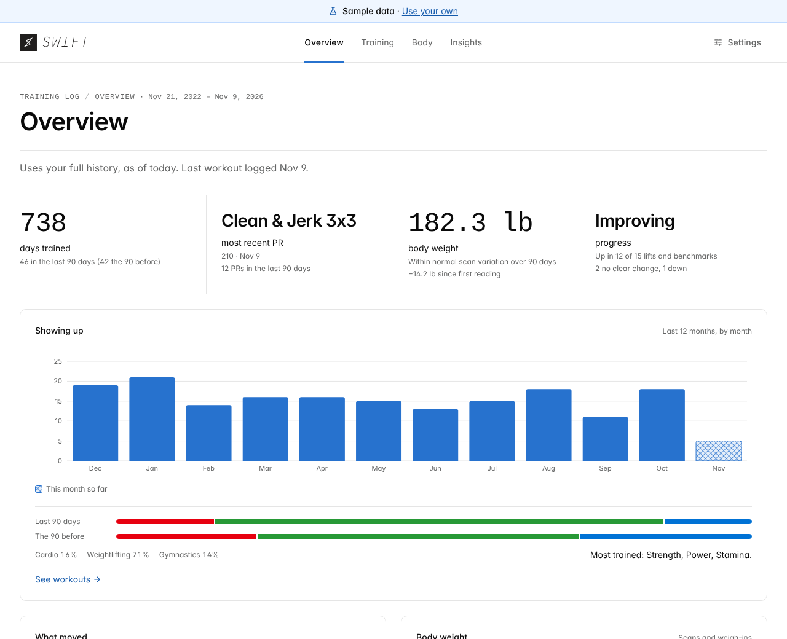
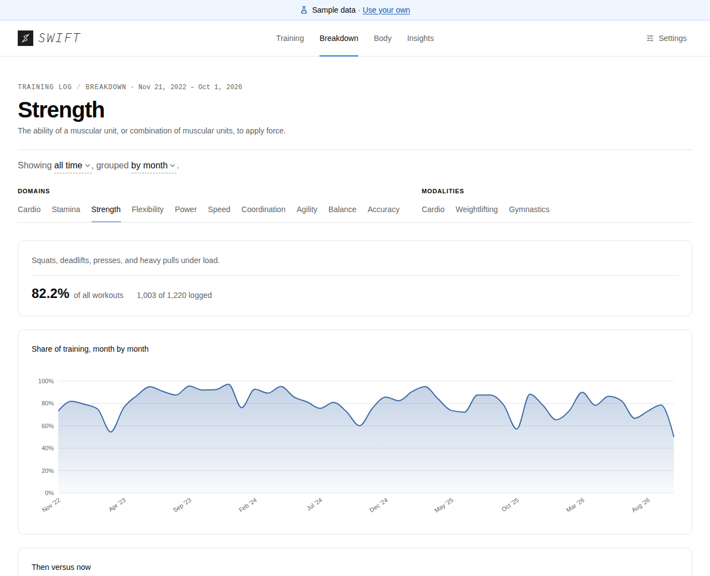
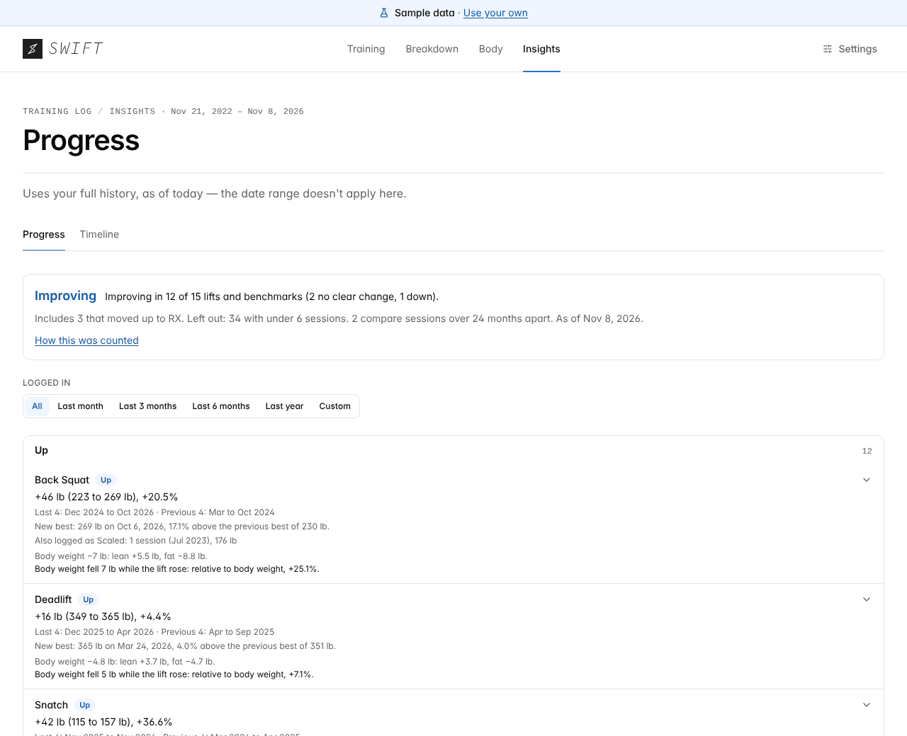

# Swift

*Training insights, no strings attached.*

[](https://github.com/ayovev/swift/actions/workflows/ci.yml)
[](LICENSE)


Swift turns a SugarWOD training-history CSV into a dashboard you can read in
a minute. It runs entirely in your browser: **[tryswift.io](https://tryswift.io)**.
There is no account to make and no server to send your file to.

<picture>
  <source media="(prefers-color-scheme: dark)" srcset="docs/images/overview-dark.png">
  
</picture>


## What it shows

- **Consistency and progress.** Workouts over time, lift and benchmark history,
  and a timeline of PRs.
- **What your training is made of.** A breakdown across the ten CrossFit
  general physical skills (the GPP domains), and the proportional mix of
  metabolic conditioning, weightlifting and gymnastics (M/W/G) in your log.
- **Is each lift moving?** A verdict for every lift and benchmark (Up, Down,
  Not tested since, No clear change), a headline across them, and the evidence
  behind each. Body weight, from an InBody export or weigh-ins you enter, is
  stated beside a verdict and never changes it.
- **A timeline.** Add the things you changed (a program, a cut) and the things
  that happened (an injury, a trip) and see them on one axis beside your
  verdicts, with a before and after for each thing you changed.

It loads one athlete's file at a time. "Coach" is a framing, not a separate
product: a coach reads an athlete's export the same way, can add their gym's
logo, name and colour to the app (see [Branding](#branding)), and there are
no multi-athlete views or comparisons. Try it without a file using the sample data
on the landing page.

<table>
  <tr>
    <td width="50%">

<picture>
  <source media="(prefers-color-scheme: dark)" srcset="docs/images/breakdown-dark.png">
  
</picture>

</td>
    <td width="50%">

<picture>
  <source media="(prefers-color-scheme: dark)" srcset="docs/images/progress-dark.png">
  
</picture>

</td>
  </tr>
  <tr>
    <td align="center"><sub>Training: one of ten GPP domains</sub></td>
    <td align="center"><sub>Progress: a verdict for each lift and benchmark</sub></td>
  </tr>
</table>

*Screenshots use the bundled sample data.*

## Privacy

Your file never leaves your browser. There is no account and no server.

| | |
| --- | --- |
| **Stays in your browser** | Your workout log, InBody history, weigh-ins, timeline entries, and your view settings, cached in the browser's own IndexedDB so a reload doesn't need a re-upload. **Start over** in Settings deletes all of it. |
| **Can leave your browser** | Anonymous usage events (page opened, upload succeeded, tab viewed) with fixed names and coarse buckets, and only when an analytics key is configured. Connection setup for device sync touches a public STUN server. |
| **Never leaves your browser** | Workout text, movement names, notes, filenames, exact row counts, body-composition values, or any identifier for you. |

### The full account

Swift has no backend, no database and no accounts. The CSV is read through the
browser's File API, parsed, classified and aggregated entirely in the page you
have open. Nothing you upload is sent anywhere.

- **The local cache.** Uploaded rows (SugarWOD and, if you add it, InBody), your
  weigh-ins and timeline entries, and your selected date range and grouping are
  kept in the browser's IndexedDB so closing the tab doesn't force a re-upload.
  It never leaves your browser. **Replace file** in Settings swaps in a fresh CSV
  for one dataset without touching anything else. **Start over** clears
  everything at once, so it asks you to confirm once real data is loaded (sample
  mode resets in one click, since nothing from the sample is ever stored).
  Clearing your browser's site data does the same, which is why Settings also has
  a file backup.
- **Branding (coaches).** A gym logo, name and brand colour are kept in the
  browser's localStorage on this device only. The logo is re-drawn in the browser
  so only its pixels are kept, with no embedded location or camera data. None of
  it is uploaded, synced, included in a backup or sent to analytics. **Start
  over** does not remove it; **Remove branding** in Settings does.
- **Device sync.** **Send to a device** and **Receive from a device** (Settings;
  the landing page offers **Sync from another device**) connect two browsers
  directly over WebRTC, with a QR code standing in for a signaling server. Nothing
  passes through a server Swift controls. Only connection setup, never your
  workout data, briefly touches a public STUN server, the same as a peer-to-peer
  video call. The workout log, body composition history, weigh-ins and timeline
  entries come across; accent, light or dark mode, grouping and date range stay
  on each device. If the receiving device already has data you confirm once before
  anything is replaced. A sync is all or nothing, and if any part of what arrives
  is unusable nothing is applied. Both devices need the current version.
- **Analytics.** When a PostHog key is configured, Swift sends anonymous
  usage events: page opened, upload attempted, succeeded or failed, sample data
  used, sync attempted, succeeded or failed, tab viewed, a few named interactions
  (a backup downloaded or restored, branding saved), theme, date range and
  grouping changed. The payloads carry only fixed strings and coarse buckets,
  never workout text, filenames, row counts or any identifier. `SwiftEvent` in
  `src/lib/posthog.ts` types the whole surface narrowly, and
  `tests/analytics.test.ts` and `tests/syncAnalytics.test.ts` assert it.

### Check it yourself

You don't have to take that on trust. Swift is open source and the claim is
small enough to verify.

- **In your browser.** Open DevTools, go to the Network tab, and upload a file.
  The only requests are the app's own files and, if analytics is on, small usage
  events. None of them contain your data.
- **In the code.** There is no backend directory and no API layer. The three
  things that touch the network are the sample-file download in `src/App.tsx`
  (from our own origin), the analytics client in `src/lib/posthog.ts`, and the
  STUN lookup in `src/lib/sync/webrtcTransport.ts`.
- **In the headers.** `vercel.json` sets a Content-Security-Policy on the live
  site. Its `connect-src` allows requests only to the app's own origin and
  PostHog, so the page can't make a fetch or XHR call to anywhere else. (WebRTC
  device sync is separate: it connects browser to browser, and only the STUN
  lookup leaves for a public server.)
- **In the types.** `SwiftEvent` in `src/lib/posthog.ts` is the entire analytics
  surface, written as a narrow union rather than a free-form object, so adding
  free-form content to an event is a type error.
- **In the tests.** `tests/analytics.test.ts` rebuilds real workout titles from
  the sample export and fails if any of them shows up in an event payload.
  `tests/syncAnalytics.test.ts` does the same for sync.
- **On your own copy.** Fork it, leave `VITE_PUBLIC_POSTHOG_KEY` empty, and
  Swift sends no analytics at all. It builds to static files you can host
  anywhere.

## Quick start

Requires Node and npm. Use npm, not yarn or pnpm.

```sh
npm install
cp .env.example .env
npm run dev
```

Other scripts:

```sh
npm run build      # tsc -b && vite build, output in dist/
npm run preview    # serve the production build locally
npm test           # vitest run
npm run test:watch # vitest in watch mode
npm run typecheck  # tsc -b --noEmit
```

`.env.example` has an empty `VITE_PUBLIC_POSTHOG_KEY`. Leave it empty: analytics is optional and no-ops cleanly without a key, so the app runs normally. `.env` is gitignored; `.env.example` is committed with no real value in it.


## Using Swift

**Your own export.** In SugarWOD, open your training log and choose **Export
Workouts**, then drop the CSV on Swift's upload area or pick it with the file
picker. Swift expects SugarWOD's own export columns (`date`, `title`,
`description`, `best_result_raw`, `best_result_display`, `score_type`,
`barbell_lift`, `rx_or_scaled`, `pr`). If a file is missing columns, is empty,
isn't a CSV or has no readable dates, you get a plain-language message saying
which, not a parser error.

**Sample data.** The landing page has an "Or try it with sample data" option that
loads a bundled export and renders the full dashboard with no upload. A one-line
strip, "Sample data · Use your own", stays at the top the whole time so it is
never mistaken for your results; **Use your own** returns to the upload screen.

**Body composition, optionally.** An InBody scan-history export is a separate,
optional upload with its own view under **Body**. It expects InBody's own
columns; only `date` and `Weight(lb)` are required, so a slimmer export works.
It adds body-weight context to the Insights views. You can also enter weigh-ins
by hand on the Body Comp view (pounds only, one per day, with an optional note);
on a day with both, the scan is used.

**Insights.** **Progress** gives each lift and named benchmark a verdict (Up,
Down, Not tested since or No clear change) from its recent sessions, with a
headline across them and a chart behind each row. RX and Scaled are judged
separately. **Timeline** is where you add what you changed (a program, a cut) and
what happened (an injury, a trip): each entry has a kind, an area (Training,
Nutrition, Health, Travel or Other), a start date and an end date or Ongoing.
Entries sit on one axis above the verdicts. For something you changed, Swift
also shows how your lifts and benchmarks compared during it against just before
it. An entry is context: it never changes a verdict, and Swift never says it
caused one.

**Finding your way around.** The header has four sections. **Overview** is where
things stand now, from your whole history: days trained, your most recent PR,
body weight and the Progress headline, each opening its own section. **Training**
holds your workout list, Lifts (every lift, benchmark and PR), the ten GPP
domains, the three modalities and a Movements view, where you can pick one
movement or a whole family, such as every kind of clean, and narrow it to
dumbbell, kettlebell or barbell when your workouts say which. **Body** is body
composition. **Insights** is Progress and Timeline. The date range and grouping
sit under each page's title as a sentence you can click: "Showing all time,
grouped by month." To see the workouts behind a chart point, click or tap it, or
focus the chart and use the arrow keys and Enter. On a domain, modality or
Movements chart the list below narrows to that month, week or quarter; on
Overview's months or a lift's dots you get a link to those workouts. You can also
drag across a chart to set the date range. Every chart has a table version: the
**Table** switch in a chart's header flips them all. Replacing a file, syncing,
backup, accent colour, dark mode and Start over are all in **Settings**.

**Updating your data.** A fresher export doesn't need a fresh start. In
**Settings**, **Replace file** next to your workout log swaps in a new SugarWOD
CSV, and the one next to body composition does the same for InBody (also on the
Body Comp view). Each replaces only that dataset. When the stored log is more
than 30 days old, Overview and the Insights views show a quiet line offering the
same action.

**Backing up.** Clearing your browser's site data, or moving to a new computer,
would lose what is stored here, including timeline entries and weigh-ins, which
exist nowhere else. **Settings → Backup → Download** saves one file with your
workout log, body composition history, weigh-ins and timeline entries (not
accent, mode, grouping, date range or branding). **Restore**, in Settings and on
the landing page for a fresh browser (or by dropping the file on the upload
area), replaces each dataset the file contains after you confirm, and restores
nothing if any part of the file is unusable. By default the file is plaintext and
holds your full training and body composition history, so keep it somewhere
private. To protect it, tick **Protect with a passphrase** (at least 8
characters, entered twice): the file is encrypted in your browser with AES-256-GCM
and Restore asks for the passphrase. Swift can't recover a forgotten passphrase,
since there is no account and no server, so a password manager is a good home for
it. An encrypted file still shows its export time and rough size, nothing about
what is inside.

**Syncing from another device.** The landing page's **Sync from another device**
(and, once you have your own data loaded, **Send to a device** and **Receive from
a device** in Settings) walks you through a two-QR pairing: the device with your
data shows a code, the other scans it and shows a code back, and once that is
scanned too your data transfers directly between the two browsers. It is all or
nothing, with one confirmation if anything would be replaced. See
[Privacy](#the-full-account) for how that stays server-free.

### Branding

A coach can add their gym's logo, name and brand colour: **Settings → Branding**,
shown while the role is set to Coach (change it under **Role**). The logo appears
beside the Swift mark in the header and on the landing page; Swift's own mark is
always there too. The colour becomes the accent, adjusted automatically if it
would be hard to read in either mode, and the form says when it did that. The
logo can be a PNG, JPEG or WebP up to 5 MB; SVG isn't accepted. A logo that would
disappear against the page (white on light, black on dark) sits on a small plate.
Branding stays on this device: it isn't uploaded, synced or included in a backup,
and **Start over** doesn't remove it, so a coach moving between athletes keeps it.
**Remove branding** clears it. Athletes don't see a coach's branding; it shows
only on the coach's own device.

## How classification works

Both classifiers read the same input: the workout's `title`, `description` and
`barbell_lift` fields joined and lowercased. There is no lookup table of known
workouts and no model, only keyword and phrase matching over free text.

Matching is plain substring containment, not word-boundary matching, on purpose.
SugarWOD descriptions often join lines with no separator
(`21-15-9DeadliftsPull-ups-200m run after each round`), so the character before a
genuine movement name is often a letter, and a boundary rule would silently drop
real matches. The cost is the occasional false positive, which a small measured
exclusion list handles one keyword at a time (`carry` inside `carryover`).
Very short abbreviations such as `du` or `kb` use a stricter token mode instead.
Substring matching also catches most inflections (`run` finds `runs` and
`running`); where the stem changes, the matcher also searches the consonant-plus-y
to `i` form, so `carry` finds `carries` and `heavy` finds `heavier`.

**The ten GPP domains** (Cardiovascular/Respiratory Endurance, Stamina, Strength,
Flexibility, Power, Speed, Coordination, Agility, Balance, Accuracy) each have a
keyword list, and a workout hits a domain if any of its keywords appear.
**Domains are not mutually exclusive**: most workouts hit several, so a month's
domain percentages sum to well over 100%, and the normalized stacked chart
divides by total tags rather than total workouts. Swift keeps the keyword that
triggered each match and shows it in the drill-down, so you can check the
reasoning.

**The M/W/G modality mix** is proportional rather than a single label and
follows canonical CrossFit semantics:

- **M, metabolic conditioning** (Cardio in the app): monostructural work only.
  Running, rowing, biking, skiing, jumping rope. Not "anything that makes you
  breathe hard".
- **W, weightlifting**: an external load moved by you. Barbell, dumbbell,
  kettlebell, odd objects.
- **G, gymnastics**: your own bodyweight moved through space.

Each distinct movement in a workout contributes equal weight to its modality, and
a movement counts once however often it appears. Fran (thrusters and pull-ups) is
50% W, 50% G and 0% M: punishing metabolically, with nothing monostructural in
it. The three shares are rounded so they always sum to exactly 100. Longer
movement phrases win over shorter ones (`power clean` over `clean`, `ring row`
over `row`). Workouts where no movement is recognised are reported as
unclassified and left out of every average, and the dashboard says how many.

Every movement has a stable id, and a variant CrossFit lists separately (a
strict, kipping or butterfly pull-up; a legless rope climb) has its own. A family
groups the variants of one movement, so the Movements view can show every kind of
pull-up or only the strict ones. The implement (dumbbell, kettlebell, barbell) is
a separate label read from the words right before a movement ("db snatches"); it
never adds a movement or changes a split, and a workout that doesn't say gets no
label rather than a guess.

**This is a heuristic, not ground truth.** It is inference over free text your
gym wrote, so a workout can land somewhere surprising if things are named
unusually. Flexibility reads low for almost everyone, because mobility work rarely
gets logged as its own entry. Every tab shows what it matched on so you can judge
for yourself.

## Testing

```sh
npm test
```

Vitest in a jsdom environment, suites in `tests/`. Coverage is on the logic
rather than the UI, and there are no end-to-end browser tests; real two-device
WebRTC pairing and camera QR scanning are checked by hand before a change to sync
ships. The GPP pipeline is compared row by row against the output of the original
validated Python reference implementation, committed as a fixture
(`tests/fixtures/python_reference_output.json`), so the suite needs no Python and
every intentional divergence is listed in the test itself. Accessibility and
contrast are enforced by tests (`themeContrast.test.ts`, and others named in
CLAUDE.md), with axe-core runs in a real browser for the rest.
`scripts/generate_parity_fixture.py` regenerated that fixture once; it is
dev-only and never bundled.

## More

- [CONTRIBUTING.md](CONTRIBUTING.md) and [SECURITY.md](SECURITY.md).
- [CLAUDE.md](CLAUDE.md) is the developer reference: project structure, how the
  code is organised, the decisions that must not be "improved" and the tests that
  pin them, with the reasoning next to each.

Stack: Vite, React, TypeScript, Tailwind CSS, shadcn/ui, Recharts, PapaParse,
dayjs, and the browser's native WebRTC and Web Crypto.

## Known limitations

The progress verdict and the body-weight noise band are tuned on the
bundled sample and one real export, so their thresholds are starting
points. They are all in `src/lib/analytics/insightConfig.ts`, each with a note on how it was
chosen. Check them against your own history before trusting a number.

Other things to know: RX and Scaled lifts are judged separately, and an entry on the timeline is
context only: it never changes a verdict.

## Deployment

Static SPA on Vercel. `vercel.json` is already configured — `npm run build`, output in `dist`, with a catch-all rewrite to `index.html`. There is no backend to deploy or operate. If PostHog is wanted in production, set `VITE_PUBLIC_POSTHOG_KEY` as a build-time environment variable; without them the deployed app simply runs without analytics.

## License

[MIT](LICENSE). Fork it, read it, run your own copy.

Swift is an independent project and is not affiliated with or endorsed by
SugarWOD, InBody or CrossFit.
